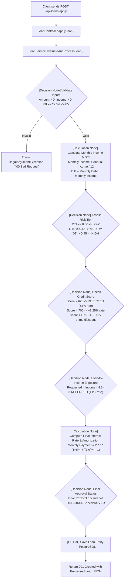
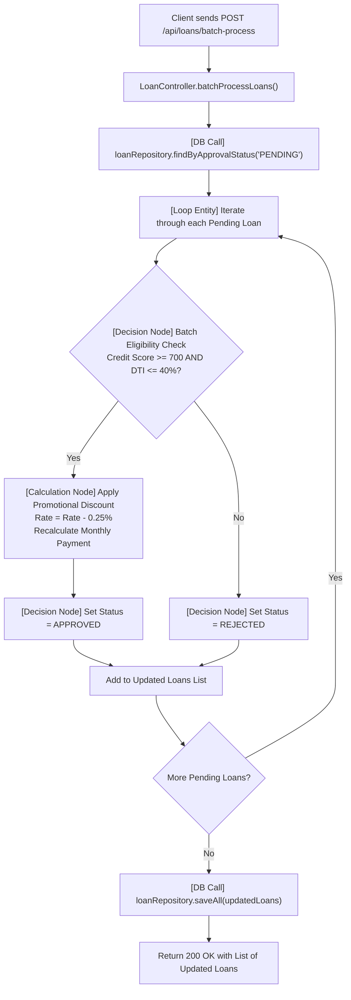
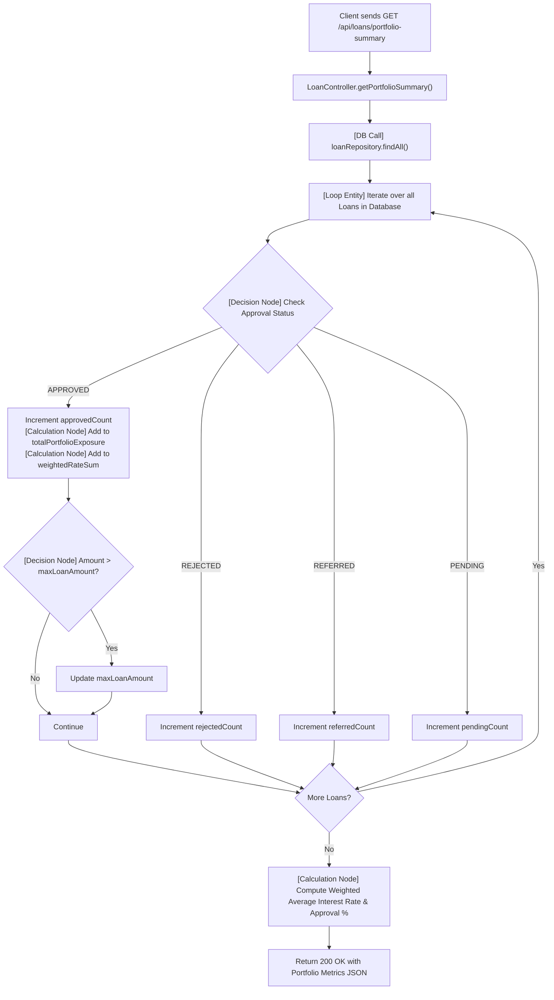

# Loan Processing Service — Application Details & Architecture Guide

Welcome to the comprehensive documentation for the **Loan Processing Spring Boot Application**. This document is designed so that anyone—from a non-technical reader to an enterprise architect—can understand what the application does, how it works, how it is built, and how to run and test it locally.

---

## 1. High-Level Overview (For Beginners & Non-Technical Readers)

### What Does This Application Do?
Imagine a digital **Loan Officer** working at a mortgage bank:
- When a borrower applies for a loan, they provide their requested loan amount, credit score, annual income, and monthly debts.
- Instead of a human manually reviewing spreadsheets and calculating loan formulas by hand, this application:
  1. **Validates** the application to ensure the information is reasonable.
  2. **Calculates** key financial numbers, such as the borrower's **Debt-to-Income (DTI)** ratio and the exact **monthly mortgage payment**.
  3. **Makes decisions** using bank underwriting rules (e.g., borrowers with credit scores below 620 are rejected, prime borrowers get discounted rates, and high-risk applicants are flagged).
  4. **Stores** the record safely in a **PostgreSQL database**.
  5. **Reviews backlog loans in batches** to apply promotional rate discounts.
  6. **Generates portfolio analytics** showing the bank's total loan exposure, approval rates, and average interest rates.

---

## 2. Technology Stack

| Category | Technology / Library | Version | Description |
| :--- | :--- | :--- | :--- |
| **Language** | Java (JDK) | 21 (LTS) | Modern Java runtime with performance enhancements. |
| **Framework** | Spring Boot | 3.3.4 | Industry-standard microservice and web application framework. |
| **Web Layer** | Spring Web (MVC) | 3.3.4 | Provides RESTful API endpoints and JSON serialization. |
| **Data Layer** | Spring Data JPA / Hibernate | 3.3.4 | Object-Relational Mapping (ORM) and repository abstractions. |
| **Database Driver**| PostgreSQL JDBC Driver | 42.7.4 | Official driver for connecting to PostgreSQL databases. |
| **Target Database**| PostgreSQL | 14+ | Relational SQL database for robust persistence. |
| **Build Tool** | Apache Maven | 3.9+ | Dependency management and build automation. |

---

## 3. Project Structure, File Count & Lines of Code (LOC)

The application was crafted following strict enterprise micro-architecture constraints:
- **No inner classes**: Every class/interface is an independent, top-level file.
- **Minimal file footprint**: Total application source code files is limited to 4 core Java files plus 1 Maven build descriptor (`pom.xml`).

### File Inventory & Exact LOC Metrics

| File Name | Location | Type | Role | Lines of Code (LOC) |
| :--- | :--- | :--- | :--- | :---: |
| `Loan.java` | `simple_loan_application/src/main/java/com/hexaware/loanapp/` | Java Entity | Database Model (JPA Table `loans`) | 99 |
| `LoanRepository.java` | `simple_loan_application/src/main/java/com/hexaware/loanapp/` | Java Interface | Spring Data JPA Data Access Layer | 9 |
| `LoanService.java` | `simple_loan_application/src/main/java/com/hexaware/loanapp/` | Java Service | Business Logic, Decisions, Calculations & Loops | 194 |
| `LoanController.java` | `simple_loan_application/src/main/java/com/hexaware/loanapp/` | Java Controller | REST API Endpoints & `@SpringBootApplication` Entrypoint | 68 |
| `pom.xml` | `simple_loan_application/` | XML Descriptor | Maven Build & Dependency Configuration | 48 |
| **Total Application Core Files** | | | **4 Java Files + 1 Build File** | **418 LOC** |
| `README.md` | Project Root | Markdown | Repository Header | 1 |
| `application_details.md` | Project Root | Markdown | Architecture & Operations Manual | *(This file)* |

---

## 4. Architectural Concepts Explained

To make the code readable by static analysis engines, AST parsers, and workflow engines, the code is organized around 5 foundational concepts:

```
[REST Client / Browser]
         │
         ▼ (HTTP Request)
[1. Functional Flow: Controller Endpoint]
         │
         ▼
[2. Service Layer: Workflow Engine]
   ├─► [3. Decision Nodes]     ── (if/else checks: DTI thresholds, credit cutoffs)
   ├─► [4. Calculation Nodes]  ── (Math: DTI, compound interest, amortization)
   └─► [5. Loop Entities]      ── (for-each loops across collections of records)
         │
         ▼
[6. DB Calls: Repository]
         │
         ▼ (SQL / JDBC)
[7. PostgreSQL Database (`loans` table)]
```

1. **Functional Flow**: An end-to-end automated business process triggered by an incoming HTTP request, orchestrating services, calculations, decisions, and database persistence.
2. **Decision Node**: A logical branching point (`if / else`) where criteria determine the path of the workflow (e.g., credit score rating, risk categorization).
3. **Calculation Node**: A mathematical computation step (e.g., Debt-to-Income percentage, 30-year amortization compound interest calculation, weighted averages).
4. **Loop Entity**: A programmatic loop (`for (Loan loan : pendingLoans)`) that iterates through a list of database records to perform uniform logic on each entity.
5. **DB Call**: Direct interaction with the PostgreSQL database through the repository layer (`save`, `saveAll`, `findById`, `findAll`, `findByApprovalStatus`).

---

## 5. Detailed Functional Flows

### Flow 1: Loan Application Evaluation Flow (`POST /api/loans/apply`)



#### Step-by-Step Breakdown:
1. **Parameter Validation (Decision Node)**:
   - Validates that requested loan amount and annual income are strictly positive numbers.
   - Ensures credit score falls within the standard credit bureau range (300 to 850).
2. **DTI Ratio Computation (Calculation Node)**:
   $$\text{Monthly Income} = \frac{\text{Annual Income}}{12}$$
   $$\text{DTI} = \frac{\text{Monthly Debt}}{\text{Monthly Income}}$$
3. **Risk Tiering (Decision Node)**:
   - $\text{DTI} \leq 36\%$: **LOW**
   - $36\% < \text{DTI} \leq 45\%$: **MEDIUM**
   - $\text{DTI} > 45\%$: **HIGH**
4. **Credit Score Underwriting Rules (Decision Node)**:
   - Score $< 620$: Immediate `REJECTED` status with $+3.00\%$ risk penalty.
   - Score $620 - 699$: `PENDING` with $+1.25\%$ rate markup.
   - Score $\geq 760$: `PENDING` with $-0.50\%$ prime borrower discount.
5. **Exposure Multiplier Check (Decision Node)**:
   - If requested loan $> 4.5 \times \text{Annual Income}$, status becomes `REFERRED` (requires senior underwriter review) with $+1.00\%$ rate markup.
6. **Amortization Monthly Payment (Calculation Node)**:
   - Calculates monthly repayment for a standard 30-year fixed mortgage ($n = 360$ months):
   $$M = \frac{P \cdot r \cdot (1 + r)^n}{(1 + r)^n - 1}$$
   *(where $P$ is principal, $r$ is monthly interest rate $\frac{\text{Annual Rate}}{12}$, $n = 360$ months).*
7. **Final Approval Assignment (Decision Node)**:
   - If not `REJECTED` and not `REFERRED`, status is set to `APPROVED`.
8. **Persistence (DB Call)**:
   - Executes `loanRepository.save(loan)` and commits record to PostgreSQL.

---

### Flow 2: Batch Processing of Pending Loans (`POST /api/loans/batch-process`)



#### Step-by-Step Breakdown:
1. **DB Call**: Fetches all loans having `approvalStatus = 'PENDING'`.
2. **Loop Entity**: Loops over each pending loan entity sequentially.
3. **Decision Node**: Evaluates if the applicant has a good credit score ($\geq 700$) and a healthy debt ratio ($\text{DTI} \leq 40\%$).
4. **Calculation Node**:
   - Reduces annual interest rate by a promotional $0.25\%$ discount.
   - Recalculates the monthly payment using the discounted rate.
5. **Decision Node**: Upgrades status to `APPROVED`, or falls back to `REJECTED` if criteria are not met.
6. **DB Call**: Persists all modified entities in a single batch write operation (`saveAll`).

---

### Flow 3: Portfolio Risk & Summary Analytics (`GET /api/loans/portfolio-summary`)



#### Step-by-Step Breakdown:
1. **DB Call**: Reads all loan records in the database.
2. **Loop Entity**: Scans each loan to aggregate financial statistics.
3. **Decision Node**: Categorizes loans into `approved`, `rejected`, `referred`, or `pending`.
4. **Calculation Node**:
   - Sums total capital committed across approved loans:
     $$\text{Total Exposure} = \sum \text{Amount}_{\text{approved}}$$
   - Tracks the highest single loan issued.
   - Computes weighted average interest rate:
     $$\text{Weighted Average Rate} = \frac{\sum (\text{Amount}_i \times \text{Rate}_i)}{\text{Total Exposure}}$$
   - Computes overall approval percentage rate:
     $$\text{Approval Rate} = \left(\frac{\text{Approved Count}}{\text{Total Loans}}\right) \times 100\%$$

---

### Flows 4 & 5: Loan Retrieval Endpoints
- **Get All Loans (`GET /api/loans`)**: Fetches all records from PostgreSQL (`loanRepository.findAll()`).
- **Get Loan by ID (`GET /api/loans/{id}`)**: Performs `loanRepository.findById(id)`. Uses a **Decision Node** (`optionalLoan.isPresent()`) to return `200 OK` with the record, or `404 Not Found` if the ID does not exist.

---

## 6. How to Run & Test in Local Environment

### Step 1: Prerequisites
Make sure the following tools are installed on your machine:
- **Java 21** (`java -version`)
- **Maven 3.8+** (`mvn -version`)
- **PostgreSQL 14+** (running locally on port `5432` OR via Docker)

---

### Step 2: Start PostgreSQL Database

#### Option A: Using Docker (Recommended — 10 seconds setup)
If Docker is installed, run this single command in terminal:
```bash
docker run --name local-postgres -e POSTGRES_DB=loandb -e POSTGRES_USER=postgres -e POSTGRES_PASSWORD=postgres -p 5432:5432 -d postgres:16-alpine
```

#### Option B: Using Existing Local PostgreSQL
Connect to your PostgreSQL client (pgAdmin, psql, DBeaver) and run:
```sql
CREATE DATABASE loandb;
```

---

### Step 3: Run the Spring Boot Application

From the application directory (`simple_loan_application`), run:

```bash
cd simple_loan_application
mvn spring-boot:run
```

The application will start on port `8080` and will automatically connect to PostgreSQL and create the `loans` table.

> [!TIP]
> If your PostgreSQL has different credentials, you can override them via environment variables or command-line flags without changing any code:
> ```bash
> cd simple_loan_application
> mvn spring-boot:run -Dspring-boot.run.arguments="--spring.datasource.url=jdbc:postgresql://localhost:5432/loandb --spring.datasource.username=myuser --spring.datasource.password=mypassword"
> ```

---

## 7. Step-by-Step API Testing Guide (Ready-to-Use Examples)

You can test these endpoints using **curl**, **Postman**, or **PowerShell**.

### Test 1: Submit a Prime Loan Application (Expected: `APPROVED`)

#### cURL Command:
```bash
curl -X POST http://localhost:8080/api/loans/apply \
  -H "Content-Type: application/json" \
  -d '{
    "applicantName": "John Doe",
    "requestedAmount": 350000.0,
    "creditScore": 780,
    "annualIncome": 120000.0,
    "monthlyDebt": 1500.0
  }'
```

#### PowerShell:
```powershell
Invoke-RestMethod -Uri "http://localhost:8080/api/loans/apply" -Method Post -ContentType "application/json" -Body '{
  "applicantName": "John Doe",
  "requestedAmount": 350000.0,
  "creditScore": 780,
  "annualIncome": 120000.0,
  "monthlyDebt": 1500.0
}'
```

#### Expected Response (`201 Created`):
```json
{
  "id": 1,
  "applicantName": "John Doe",
  "requestedAmount": 350000.0,
  "creditScore": 780,
  "annualIncome": 120000.0,
  "monthlyDebt": 1500.0,
  "debtToIncomeRatio": 0.15,
  "interestRate": 0.06,
  "monthlyPayment": 2098.43,
  "riskTier": "LOW",
  "approvalStatus": "APPROVED"
}
```

---

### Test 2: Submit a Low Credit Loan (Expected: `REJECTED`)

#### cURL Command:
```bash
curl -X POST http://localhost:8080/api/loans/apply \
  -H "Content-Type: application/json" \
  -d '{
    "applicantName": "Jane Smith",
    "requestedAmount": 200000.0,
    "creditScore": 580,
    "annualIncome": 60000.0,
    "monthlyDebt": 1200.0
  }'
```

#### Expected Response (`201 Created`):
```json
{
  "id": 2,
  "applicantName": "Jane Smith",
  "requestedAmount": 200000.0,
  "creditScore": 580,
  "annualIncome": 60000.0,
  "monthlyDebt": 1200.0,
  "debtToIncomeRatio": 0.24,
  "interestRate": 0.095,
  "monthlyPayment": 1681.71,
  "riskTier": "LOW",
  "approvalStatus": "REJECTED"
}
```

---

### Test 3: Submit a Moderate Loan (Expected: `PENDING`)

#### cURL Command:
```bash
curl -X POST http://localhost:8080/api/loans/apply \
  -H "Content-Type: application/json" \
  -d '{
    "applicantName": "Robert Brown",
    "requestedAmount": 250000.0,
    "creditScore": 710,
    "annualIncome": 90000.0,
    "monthlyDebt": 2200.0
  }'
```

#### Expected Response (`201 Created`):
```json
{
  "id": 3,
  "applicantName": "Robert Brown",
  "requestedAmount": 250000.0,
  "creditScore": 710,
  "annualIncome": 90000.0,
  "monthlyDebt": 2200.0,
  "debtToIncomeRatio": 0.2933,
  "interestRate": 0.065,
  "monthlyPayment": 1580.17,
  "riskTier": "LOW",
  "approvalStatus": "PENDING"
}
```

---

### Test 4: Run Batch Processing on Pending Loans

#### cURL Command:
```bash
curl -X POST http://localhost:8080/api/loans/batch-process
```

#### Expected Response (`200 OK`):
The pending loan for "Robert Brown" is evaluated by the batch loop and approved with a discounted interest rate ($6.50\% \to 6.25\%$) and a lower monthly payment:
```json
[
  {
    "id": 3,
    "applicantName": "Robert Brown",
    "requestedAmount": 250000.0,
    "creditScore": 710,
    "annualIncome": 90000.0,
    "monthlyDebt": 2200.0,
    "debtToIncomeRatio": 0.2933,
    "interestRate": 0.0625,
    "monthlyPayment": 1539.29,
    "riskTier": "LOW",
    "approvalStatus": "APPROVED"
  }
]
```

---

### Test 5: Fetch Portfolio Summary Analytics

#### cURL Command:
```bash
curl -X GET http://localhost:8080/api/loans/portfolio-summary
```

#### Expected Response (`200 OK`):
```json
{
  "totalLoansAnalyzed": 3,
  "approvedCount": 2,
  "rejectedCount": 1,
  "referredCount": 0,
  "pendingCount": 0,
  "approvalRatePercentage": 66.67,
  "totalApprovedExposure": 600000.0,
  "maxSingleLoanExposure": 350000.0,
  "weightedAverageInterestRate": 0.061
}
```

---

### Test 6: Retrieve a Loan by ID

#### cURL Command:
```bash
curl -X GET http://localhost:8080/api/loans/1
```

#### Expected Response (`200 OK`):
Returns the full record for Loan ID 1. If requesting a non-existent ID (e.g., `999`), returns `404 Not Found`.

---

## 8. Summary of Benefits & Architecture Highlights

1. **Lightweight & Modular**: Only 4 Java source files, yet implements enterprise-grade underwriting workflows.
2. **Deterministic & Auditable**: Every underwriting decision (DTI ratio, rate adjustment, credit cutoff) is mapped to explicit decision and calculation nodes.
3. **Database-Agnostic with PostgreSQL Default**: Out-of-the-box configuration for PostgreSQL with automatic table creation via Hibernate DDL.
4. **Zero Overhead**: No nested or inner classes, making the application easy to parse with code analysis tools, AST parsers, and visual workflow builders.
